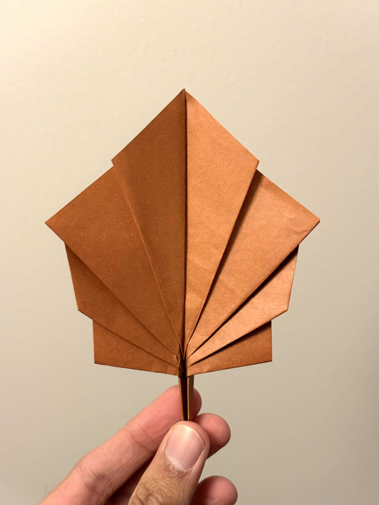
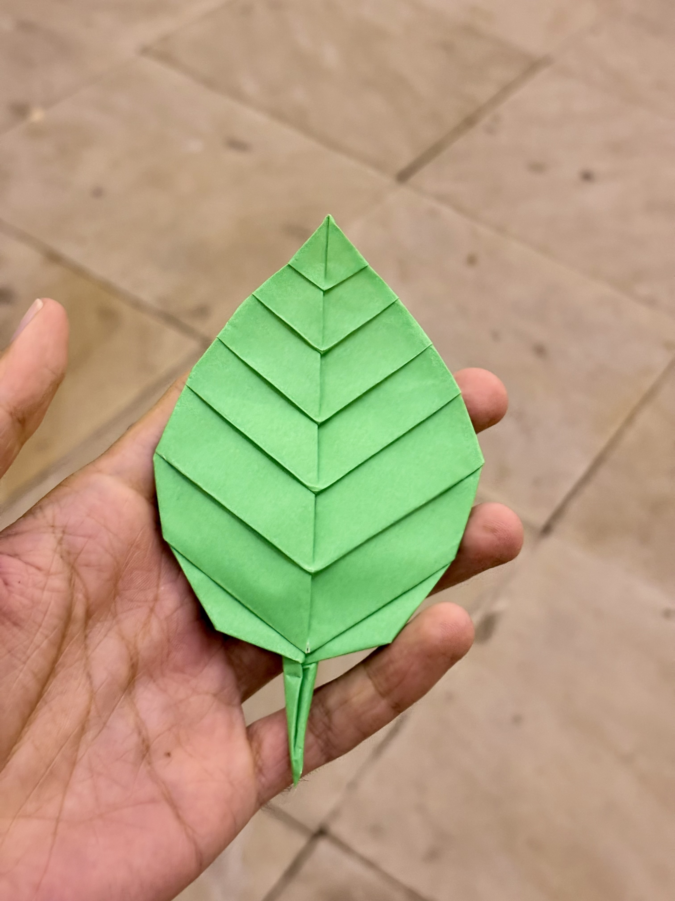

## Diagrams

I MADE DIAGRAMS! I want as many people to be able to fold leaves as possible, so I made some diagrams. Fold some leaves before the season is over.

[Leaf Diagrams](/diagrams/leaf-diagrams.pdf)

---

## Leaf

I really like leaves. Staring at leaves in the fall brings me so much joy. I wanted to capture that feeling in origami. It's far more literal than my other work, but I don't mind. I just like leaves.

I was fortunate enough to teach this at the University of Chicago as part of a lecture on free folding.

---

## More Leaves

